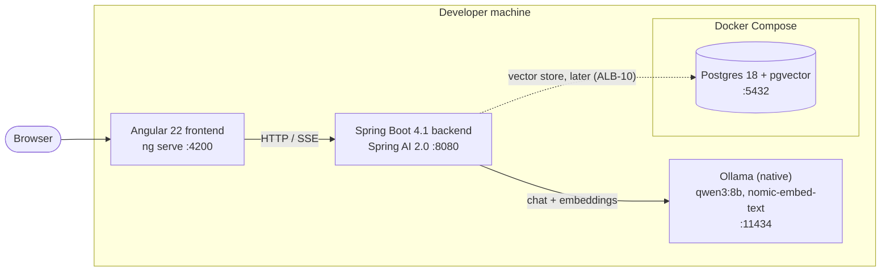
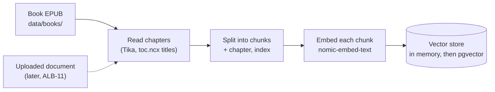
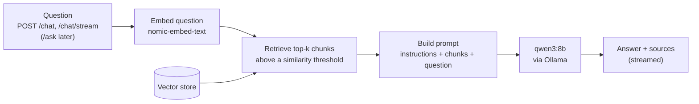

# Architecture

How ask-my-docs fits together, and how a question becomes an answer. Decisions behind it are in the [ADRs](adr/README.md).

> **Status (2026-11-19):** the backend answers questions about the book at `POST /chat` (ALB-30), and streams the answer as server-sent events at `POST /chat/stream` (ALB-31). At startup it reads the book chapter by chapter, splits it into chunks and embeds them with `nomic-embed-text` into an in-memory vector store; each question gets only the closest chunks (ALB-32). Answers don't cite their sources yet (ALB-12). It serves its OpenAPI document and Swagger UI in the `dev` profile, which `./mvnw spring-boot:run` turns on. The rest of the RAG flow isn't built yet: the tables below name the Linear issue that builds each part. Update this page in the same PR as the code it describes.

## Components

| Component | Role | Built? |
| --- | --- | --- |
| Frontend (`frontend/`) | Chat page where the user asks questions and reads answers with their sources | Skeleton only; chat UI is Week 3 |
| Backend (`backend/`) | REST API: loads and indexes the document, retrieves passages, prompts the model, returns answers. API docs at `/swagger-ui.html` in the `dev` profile `POST /chat` (ALB-30), streamed at `POST /chat/stream` (ALB-31), both from retrieved passages (ALB-32); sources come with ALB-12 |
| Ollama | Runs the chat model `qwen3:8b` and the embedding model `nomic-embed-text` on the host, using the Apple GPU ([ADR 0001](adr/0001-spring-ai-and-ollama-as-llm-stack.md)) | External; `qwen3:8b` configured with an 8k context, thinking off and a 30-minute keep-alive; `nomic-embed-text` for embeddings |
| Postgres + pgvector | Persistent vector store ([ADR 0002](adr/0002-in-memory-vector-store-then-pgvector.md)) | Runs in Compose; the backend doesn't use it until ALB-10 |

## RAG flow

Retrieval-augmented generation: the app finds the passages of the document closest to the question and gives only those to the model, which answers from them.

**Indexing**, once at startup:

**Asking a question**, on every request:

| Step | What happens | Built in |
| --- | --- | --- |
| Read | The book (an EPUB kept out of git in `data/books/`) is read at startup chapter by chapter, in spine order, with Tika's lenient HTML parser; markup and image names are dropped and each chapter is titled from the EPUB's `toc.ncx` (`book/BookLoader`). Later, uploaded documents too. | Built (ALB-30, chapters ALB-32); uploads ALB-11 |
| Chunk | Each chapter is split into chunks of about 400 tokens (`app.retrieval.chunk-size`, Spring AI's `TokenTextSplitter`), each tagged with its chapter title and its index in the book (`book/BookChunker`). | Built (ALB-32) |
| Embed and store | Each chunk is embedded as `search_document: …` with `nomic-embed-text` into Spring AI's in-memory `SimpleVectorStore`, before the app accepts requests, all or nothing (`book/BookIndex`). If Ollama or the model is missing, the app starts without an index and the chat endpoints answer 503. pgvector later. | Built, in memory (ALB-32); pgvector ALB-10 |
| Retrieve | The question is embedded as `search_query: …`, and at most 4 chunks (`app.retrieval.top-k`) with cosine similarity ≥ 0.6 (`app.retrieval.similarity-threshold`) come back with their text, chapter, index and score (`BookIndex.search`). | Built (ALB-32) |
| Prompt and answer | The model gets instructions to answer only from the passages, the passages with their chapters, and the question (`chat/BookPrompt`). No passage above the threshold means the prompt says so, and the answer says the book doesn't cover it. The instructions start every prompt, so Ollama reuses that part of its cache; the chat model is loaded at startup by a warm-up request. | Built (ALB-30, retrieval ALB-32) |
| Respond | `/chat` returns one answer; `/chat/stream` streams it as server-sent events; `/ask` streams it with the passages used as sources. | `/chat` built (ALB-30); `/chat/stream` built (ALB-31): `token` events, then `done` or `error`; `/ask` ALB-12 |

Endpoints have no `/api` prefix. Each one is documented in the OpenAPI document as it's added (see [README → Documentation](../README.md#documentation)).
