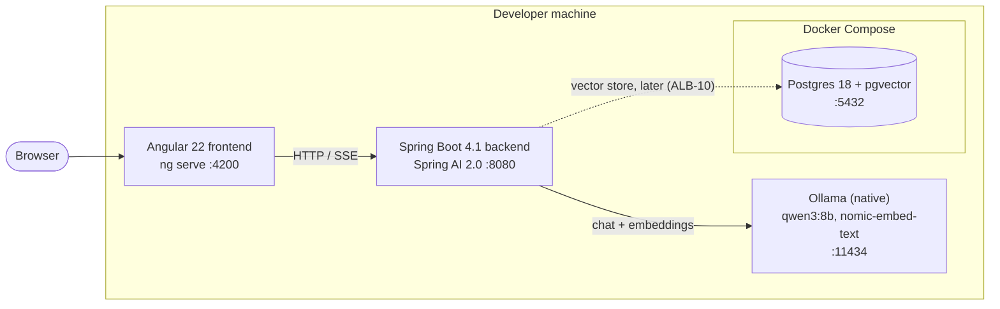
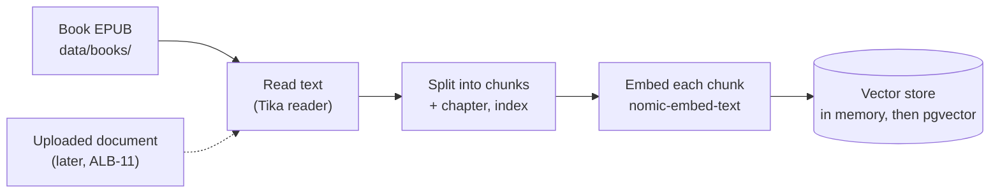
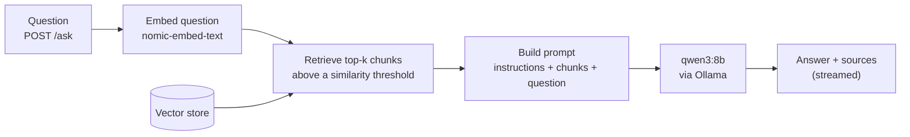

# Architecture

How ask-my-docs fits together, and how a question becomes an answer. Decisions behind it are in the [ADRs](adr/README.md).

> **Status (2026-11-11):** the backend answers questions about the book at `POST /chat` (ALB-30). It reads the book at startup and sends all of it to `qwen3:8b` with every question; there's no retrieval yet. It serves its OpenAPI document and Swagger UI in the `dev` profile, which `./mvnw spring-boot:run` turns on. The rest of the RAG flow isn't built yet: the tables below name the Linear issue that builds each part. Update this page in the same PR as the code it describes.

## Components

| Component | Role | Built? |
| --- | --- | --- |
| Frontend (`frontend/`) | Chat page where the user asks questions and reads answers with their sources | Skeleton only; chat UI is Week 3 |
| Backend (`backend/`) | REST API: loads and indexes the document, retrieves passages, prompts the model, returns answers. API docs at `/swagger-ui.html` in the `dev` profile | `POST /chat` with the whole book as context (ALB-30); streaming, retrieval and sources come with ALB-31, ALB-32, ALB-12 |
| Ollama | Runs the chat model `qwen3:8b` and the embedding model `nomic-embed-text` on the host, using the Apple GPU ([ADR 0001](adr/0001-spring-ai-and-ollama-as-llm-stack.md)) | External; `qwen3:8b` configured with a 32k context, thinking off and a 30-minute keep-alive |
| Postgres + pgvector | Persistent vector store ([ADR 0002](adr/0002-in-memory-vector-store-then-pgvector.md)) | Runs in Compose; the backend doesn't use it until ALB-10 |

## RAG flow

Retrieval-augmented generation: the app finds the passages of the document closest to the question and gives only those to the model, which answers from them.

**Indexing**, once at startup:

**Asking a question**, on every request:

| Step | What happens | Built in |
| --- | --- | --- |
| Read | The book (an EPUB kept out of git in `data/books/`) is read to text at startup with Apache Tika, chapters in order, with markup and image names dropped (`book/BookLoader`). Later, uploaded documents too. | Built (ALB-30); uploads ALB-11 |
| Chunk | The text is split into chunks of a few hundred tokens, each tagged with its chapter and position. | ALB-32 |
| Embed and store | Each chunk is embedded with `nomic-embed-text` and stored with its metadata: in memory first, pgvector later. | ALB-32; ALB-10 |
| Retrieve | The question is embedded the same way, and the closest chunks above a similarity threshold are fetched (default at most 4). | ALB-32 |
| Prompt and answer | The model gets instructions to answer only from the passages, the passages, and the question. No passage above the threshold means the answer says the document doesn't cover it. Today the "passages" are the whole book, behind the `BookContext` interface that ALB-32 reimplements with retrieval; the system prompt is the same at the start of every request, so Ollama reuses its prompt cache, warmed up at startup. | Whole book: built (ALB-30); retrieval ALB-32 |
| Respond | `/chat` returns one answer; `/chat/stream` streams it as server-sent events; `/ask` streams it with the passages used as sources. | `/chat` built (ALB-30); ALB-31, ALB-12 |

Endpoints have no `/api` prefix. Each one is documented in the OpenAPI document as it's added (see [README → Documentation](../README.md#documentation)).
